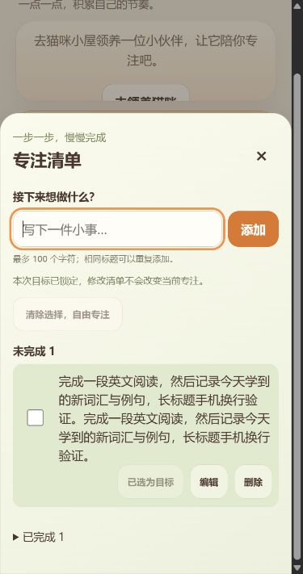
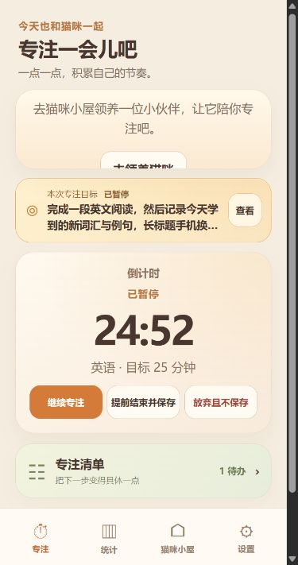

# Focus List V0.1 · M3 发布验收报告

日期：2026-10-22。代码、自动化和电脑浏览器验收完成；Android/iOS 实机发布验收仍未完成。本阶段停止，不进入下一版本。

## 修改文件

| 文件 | 职责 |
| --- | --- |
| `src/domain.ts` | 接受备份 v8，继续兼容 v1–v7；校验任务，清理备份中的无效选择 |
| `src/storage.ts` | 在同一事务中导出任务和选择，合并导入任务并恢复合适的选择 |
| `src/main.ts` | 清单读取失败时提示错误并保留计时/导航；说明备份语义；移除重复赋值 |
| `src/focus-task-list.ts` | 数据未变化时保留列表节点；关闭/销毁后忽略过期读取结果；读取错误提示 |
| `src/focus-tasks.css` | 添加按钮不受窄屏输入框挤压而变成两行 |
| `tests/focus-list-release.test.ts` | 新增备份、验证/事务回滚、30 条并发新增、10 次状态切换、编辑/删除后重开测试 |
| `tests/focus-list-read-failure.test.ts` | 新增清单读取失败时计时仍可启动的页面测试 |
| `tests/focus-task-list.test.ts` | 增加写入失败、保留输入、重复提交保护、相同数据节点复用、读取失败提示测试 |
| `tests/{core,cat-house,focus-tasks,release-compatibility,room-locations,stopwatch,wallet}.test.ts` | 更新当前导出版本断言为 v8，未修改奖励数值 |
| `README.md` | 当前版本、导入规则和本报告入口 |
| `art/release-v0.2/fixtures/*-test-only.json` | 既有测试生成器重新生成的四份合成备份：shop-80、shop-160、owned-two、owned-three；不是用户数据 |
| 本目录 | 验收结果、实际截图；生产构建输出在已忽略的 dist 中 |

## 数据和备份

- IndexedDB 仍为 v6，不新增迁移，不重置任何现有数据。
- JSON 导出升为 v8，新增 `selectedTaskId: string | null`，任务状态和时间戳仍包含在 `tasks` 中。活动会话不加入备份，已有会话目标快照不被导入修改。
- 继续采用合并：任务按 ID 合并；相同 ID 的内容不同，整批事务回滚。不会覆盖本机任务，也不通过时间戳猜测哪份任务更新。
- 本机有效的待办选择优先；没有有效选择时才恢复备份中指向未完成任务的选择。空选择、不存在/已完成任务引用或非字符串引用安全归为空。旧 v1–v7 无选择字段时不会清空本机有效选择；旧 v1–v6 无任务字段时不清空清单。
- 任务 ID、去空格后的标题、状态、整数时间戳及时间先后关系继续严格校验。任务数据错误拒绝整批导入。
- 记录、类别、钱包、签到、购买和领养原有导入规则保留；钱包不相加，冲突拒绝，当日签到按既有日期/交易 ID 去重。
- 新文件不能交给仅支持 v7 的旧应用恢复；请先升级应用，再导入 v8 备份。

## 实际执行的自动化

- 最终 `npm test`：**41 个文件 / 203 项全部通过**（M2 基线为 39 个文件 / 198 项）。
- 最终 `npm run build`：**通过**，包含动画索引、`tsc --noEmit`、Vite 构建和生产 Service Worker 缓存生成。项目没有独立 lint 命令。
- 主脚本 `index-DEAuYttw.js`：197.90 kB，gzip 50.71 kB；样式 `index-DAU_Loo4.css`：33.36 kB，gzip 7.58 kB。未增加依赖、美术素材或轮询。
- 新增验证：v8 任务选择往返、重复导入、本机选择优先、v7 保留选择、无效引用清除、非法任务字段、任务冲突事务回滚且钱包/活动会话不变、并发 30 次新增唯一 ID、连续 10 次完成/恢复、编辑后关闭重开、删除已选任务。
- UI 自动化验证：写入失败不丢输入、不产生任务，恢复后可重试；快速重复提交不会重复执行；相同数据刷新保留任务节点；关闭数据库后读取错误有提示；任务读取失败时原有计时仍可启动。
- 全量原有测试同时覆盖正/倒计时、暂停/恢复/结算去重、目标快照、统计日期边界、经验/钱包、自动签到、领养/商城、房间动画/传送/自主行为、备份旧版本和冲突规则。这里指自动化结果，不代替所有平台手动验收。

## 实际电脑浏览器验证

独立生产预览 `http://127.0.0.1:4207/`，未触碰现用 4195 页面数据。测试后关闭测试标签并停止该预览进程。

| 检查 | 结果 |
| --- | --- |
| 320、360、390 × 740 CSS 像素 | 无横向溢出；清单抽屉内部滚动；长标题换行；最终添加按钮保持单行 |
| 完成/展开/收起/刷新 | 已完成任务有删除线，折叠区可展开，刷新后状态保留 |
| 长目标、倒计时、暂停、刷新 | 当前会话目标保持不变，刷新恢复暂停和正确标题，清单选择/清除按钮被锁定 |
| 目标与计时器布局 | 稳定暂停状态三种宽度间距均 12px；控制按钮底部分别约 561.76 / 561.76 / 548.62，导航顶部 665.14，没有覆盖 |
| 离线重开 | 已缓存后停止 HTTP 服务，确认 4207 无监听，再从根地址刷新仍可用 |
| 离线读写 | 离线新增“M3 离线新增并重开”，再次刷新后仍在清单；原先 1 待办/1 完成保留，新增后 2 待办/1 完成 |
| 离线导航 | 统计空数据页、设置、初次领养页面能打开；回到专注仍为已暂停 |
| 控制台 | 测试时读取到的 error 记录为空 |

截图：

## 未验证和剩余事项

- **未实测** Android Chrome、Android 安装后 PWA、iPhone Safari 与主屏幕 PWA。
- **未实测** 真实输入法弹出/收起、系统字体放大、刘海/底部安全区及系统回收；已有 visualViewport 事件/焦点清理的自动化通过，但不能作为真实键盘验收。
- 离线测试为电脑生产缓存 + 停止本机服务，不是手机飞行模式或首次无缓存安装。
- 备份导出/导入本阶段在自动化中执行；未重复在真实手机的文件分享/下载器中操作。
- 猫咪购买、自主行为和经济系统本阶段通过现有自动化回归，未逐项重做手机人工测试。本次独立浏览器数据未购买猫咪。
- 没有发现阻塞电脑内测的失败；在完成上述手机验证前，不宣称所有发布验收项全部通过。朋友手机内测应先用可信 HTTPS，升级前导出旧备份。

## Git 和安全检查

- 在 `D:\MyDesktopPet\cat-focus-pwa` 执行 `git status --short`、`git remote -v` 均返回“not a git repository”；父目录也没有可用仓库。
- 按用户规范，不擅自初始化、不猜测或更改远程地址。**本阶段没有 commit hash，没有提交或推送。相关改动目前仅在本地。**无法提供 Git diff/暂存区/上游同步状态。
- 已复查本阶段源文件、文档和测试职责；针对常见 GitHub token/私钥特征的文件扫描无匹配，未新增凭据或个人数据。截图和测试备份仅使用合成测试内容。

