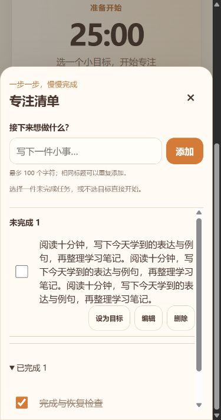
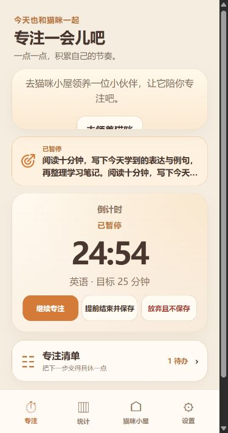

# Focus List V0.1 Polish 交付报告

日期：2026-10-22。本轮只打磨 UI 与点击语义，完成后停止。

## 实际检查与修改

当前为 Vite、TypeScript、原生 DOM/CSS。专注页通过 main.ts 装配；目标卡、清单抽屉为独立 DOM 组件。时钟更新不重建整个清单。开始会话时已有独立任务快照，暂停/恢复与清单选择分离。现有样式没有可复用的全局色彩变量，因此直接沿用 #fffaf3、#49372f、#826e60、#d47b39 等现有配色，没有新建主题体系。

| 文件 | 修改 |
| --- | --- |
| `src/main.ts` | 删除仅用于重复目标入口的 choose-focus-task 按钮及监听；保留清单入口、目标卡、类别、计时模式/时长和开始按钮。selectedFocusTaskId 仍服务于真正的目标选择，不删除 |
| `src/focus-goal-card.ts` | 复用现有 SVG 输出函数，改为带箭头的线性靶心；只展示状态和标题，未开始时显示更换，运行/暂停时隐藏更换；正常文档流与既有短过渡保留 |
| `src/category-icons.ts` | 在现有轻量 SVG 清单中补充 goal 图标；原有自定义类别 target 图标和映射未改 |
| `src/focus-task-list.ts` | 标题从 label 中移出；独立 label 仅包复选框，不给任务行/标题绑定完成事件；编辑、目标、删除仍各自操作 |
| `src/focus-tasks.css` | 奶油白清单、暖白输入、暖橙选中与复选框、暖沙色分割；浅杏目标卡去强渐变；独立 44×44px 复选框触控区，长标题和按钮可换行 |
| `tests/focus-task-list.test.ts` | 新增标题/空白/编辑/删除/目标不会误完成，独立复选框完成与恢复测试 |
| `tests/focus-goal-ui.test.ts` | 增加重复入口已删除、SVG 靶心存在、仅待开始显示更换的断言；原有状态与结算测试保留 |
| 本目录 | 实际截图和本报告 |

不修改数据库 v6、JSON 备份 v8、任务/记录格式、计时计算、统计、经验/钱包/签到、猫咪或家具业务。不增加依赖、后台任务或轮询。构建/测试按原脚本生成资源索引、合成测试备份及 dist 产物，不是新增用户数据。

## 实际执行结果

- `npm test`：**41 个文件，204 项全部通过**。保留原有测试，没有删测试或放宽奖励/时长断言。
- `npm run build`：**通过**，含 TypeScript 检查、Vite 和生产缓存生成；项目没有独立 lint 命令。
- 最终资源：`index-B9MmfHSW.js` 197.75 kB / gzip 50.65 kB；`index-HQtRomec.css` 33.34 kB / gzip 7.47 kB。
- 全量自动化包含任务 CRUD、读取/写入失败、备份兼容、无效引用清理、会话快照、正/倒计时、暂停/恢复/结算、统计、经验/钱包/签到、领养/商城、动画与自主行为等回归。这些是自动化结果，不代表均做了手机人工验收。

## 电脑浏览器实际验证

独立生产预览 `127.0.0.1:4208`，没有修改用户现用 4195 数据；结束后关闭测试页、恢复视口并停止预览。

- 点击长标题后复选框仍为 false；DOM 确认标题容器为 DIV、独立 label 仅包含 checkbox。按空格可完成任务。
- 320、360、390 × 740 模拟视口无横向溢出；复选框触控区域实测 44×44 CSS 像素。清单内部高度约 355px、内容高于容器时可滚动。完成区可折叠/展开。
- 清单实际背景 `rgb(255,250,243)`，分割线 `rgb(213,189,163)`；目标卡 `rgb(255,241,224)`。长标题换行，操作按钮未重叠。
- 选中后显示待开始，启动显示正在专注，暂停及刷新显示已暂停且标题一致。运行时更换按钮隐藏，清单仍可进入。
- 320、360、390 × 640 短屏：目标卡约 84.74px，计时卡与目标卡间距均为 12px；控制按钮底部约 561.76 / 561.76 / 548.62，导航顶部约 565.14，无覆盖。
- 提前结束沿用原确认流程；保存 6 秒后总结仍让用户决定是否完成。选择暂不完成后目标窗隐藏，原任务仍为待办。
- 没有重复的“下一步，做什么？”入口。测试读取到的控制台 error 列表为空。

截图：

## 未验证与范围外问题

- 未实测 Android/iPhone 浏览器与安装后 PWA、真实触屏/输入法、系统字体放大及设备安全区域；模拟视口不能替代实机。
- 本轮没有重复手机离线/文件分享器备份测试；备份接口按原自动化全量通过，格式未修改。
- 浏览器检查发现原有未领养猫咪空态的“去领养”按钮在紧凑猫咪展示区里部分裁切。该固定高度/overflow 来自既有布局，本轮未调整猫咪区域，也未扩大修改范围；后续可单独修复。
- 本轮没有发现需要数据库或计时核心改造的阻塞问题。

## Git 与安全

实施前后执行 git status、git remote 均返回 not a git repository。没有可确认的本地分支或上游，无法生成 Git diff/暂存区状态。

按用户约定保留本地改动，**没有初始化、commit、push 或 commit hash**，没有覆盖历史、清理或重置文件。对本次源文件/测试常见 GitHub token 和私钥特征扫描无匹配；本目录截图只含合成测试任务。
