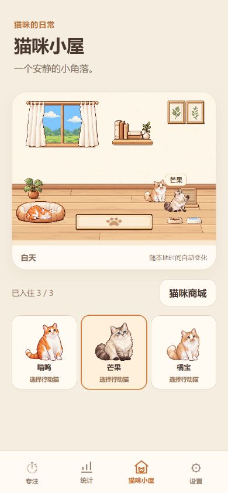
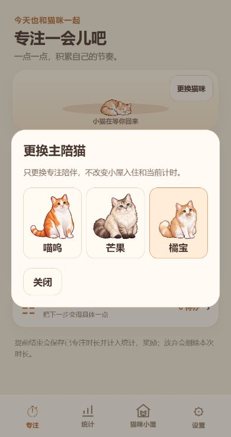

# Cat House V0.3 Polish：A—D 交付报告

日期：2026-10-22。基于原有组件增量修改；完成本轮后停止。

## A：审计与状态边界

原技术栈为 Vite、TypeScript、原生 DOM/CSS，独立图层房间为 1024×768、4:3；家具热点来自布局图层比例，动画复用单猫播放器与独立传送器。

1. **位置与行为**：场景 `feet` 保存即时脚底位置，执行器 `stable` 保存可恢复位置，设置中的 `roomLocations` 只保存猫 ID→锚点 ID。行为任务在内存 `tasks` 中，不把帧号、淡出透明度或计时任务写入数据库。
2. **家具占用**：原 `room-anchors.ts` 的租约记录占用。此前 idle 仍保留动作锚点租约，导致后续猫被阻塞。本轮保留这一统一租约管理，将动作锚点和附近待机槽位分开。
3. **打断**：此前只允许手动打断自主动作，本轮所有有效手动新指令可替换旧指令。正在淡出/淡入或退出时先安全完成该阶段；循环立即取消，不等待自然播放结束。每猫命令序号使过期请求不能启动新动作。
4. **自主行为**：仍使用原有单定时器调度器、最多两个主动任务。手动指令等待/执行时该猫受保护；完成后按原 10–20 秒冷却，记录刚完成动作，避免立即重复。取消原“没有候选动作就自动返回地毯”的分支。
5. **主陪猫与行动猫**：主陪猫仍为持久化 `catHouse.companionCatId`；行动猫仍为当前小屋 controller 的 `selectedCatId`。默认选已入住主陪猫，否则第一只入住猫；关闭选择界面/普通刷新不清选择，离开页面后按默认规则重建。

**素材核对的重要差异**：正式交互资源为 V2，三猫共 12 段 / 204 帧：每猫 eat/drink/scratch loop 和 pet once；另外有各猫自己的 idle/sleep_loop。没有真实 enter/exit 片段。本轮保留执行器的可选阶段，有资源时按顺序播放；生产配置不伪造进入/退出。退出顺序通过测试专用配置验证，不代表已有正式退出素材。

## B：入口与反馈

- 小屋卡片只列入住猫，用于选择行动猫，展示形象、名称、高亮。选择不发动作、不传送、不改变主陪猫。
- 点击家具直接映射睡觉/吃饭/喝水/抓挠/返回地毯。点击猫咪本人对该猫播放一次抚摸，不切换行动猫。
- 名字标签仅显示选中猫名；移除猫脚下选择环、家具选择虚线。阴影、家具原图和透明热点保留。
- 旧动作按钮全部移除。原面板仅用于真正重叠热区的目标消歧，不在普通家具点击后展示常驻动作面板。
- 专注猫咪区域有“更换猫咪”按钮，打开所有已拥有且有有效配置的预览选择窗。使用原存储接口保存，只改主陪猫 ID，不自动补进入住名单。
- 修正房间组件此前自动把主陪猫加入渲染列表的耦合；现在场景只按入住名单及其稳定顺序创建。

阶段入口整合检查时：41 个文件 / 204 项测试及构建通过。后续继续增加 C/D 检查，最终结果如下。

## C：指令、交接与待机

- 一个执行器接受 manual/autonomous，沿用原播放器、预加载、停止、完成回调与传送器。没有复制家具专用动画循环。
- 同猫同目标的重复请求共享当前任务，不重新播动作；新目标采用最后有效命令优先。无效目标先验证，不打断当前有效动作。
- 手动请求已占用家具时，先让原猫结束循环、完成可选退出、在附近待机并释放动作租约，再让请求猫传送到动作锚点。租约统一预留，重复释放不能清除新占用。
- 增加随家具图层定位的附近 idle 槽位。完成后猫咪在原家具附近切回自身 idle，不统一回地毯。只在明确点击地毯时回各猫保留的空闲地毯站位。
- 稳定位置仍为原来的猫 ID→锚点 ID 字典，增加可识别的 idle 槽位 ID。旧动作位置在读取时安全映射到附近 idle；不改数据库结构，也不批量重写旧数据。位置本来就不在 JSON 备份中。
- 传送异常时恢复可见性和附近安全待机点，释放租约；只有附近无可用位置的异常恢复才使用该猫保留的安全站位。
- 保留原并发上限 2。若两个不可抢占的其他手动任务都在运行，新请求仍会轻量提示稍候；不强行覆盖其他猫的手动动作。

## D：实际测试与构建

最终 `npm test`：**42 个文件 / 216 项全部通过**，基线 41 个文件 / 204 项。没有删除测试；受明确新规则影响的断言更新为附近待机、动作租约释放、关闭后保持行动猫、入口改为预览窗。

新增/补充测试覆盖：

- 同目标重复指令不重播；新指令在淡入后才运行。
- 退出中连续点击只启动最后一个有效请求，退出未结束前不传送。
- 两猫连续申请同一水盆，原猫附近 idle，最多一个动作占用者。
- 无效目标不打断当前动作；加载失败、取消、销毁、离场淡出失败不遗留租约/透明猫。
- 动作结束释放家具、附近 idle 重建恢复、地毯有另外两猫时仍可返回自己的空闲站位。
- 默认行动猫选择、面板关闭后保持选择、手动完成后的冷却与最近动作、自主失败后不快速重试。
- 换猫窗仅展示配置完整的拥有猫、保存失败提示、重复点击保护；主陪猫可属于未入住的已拥有猫，换猫不改变入住、活动会话或钱包。
- 原计时、统计、任务清单、签到、钱包、商城、动画、自主生命周期及旧版备份测试全量执行。

最终 `npm run build`：**通过**，含 TypeScript 检查、Vite 构建、生产缓存生成。没有独立 lint 命令。

产物：`index-BnnbpwaY.js` 201.93 kB（gzip 51.68 kB），`index-B6nkY5bg.css` 34.03 kB（gzip 7.56 kB）。未新增依赖、美术文件或动画素材。

### 电脑生产浏览器实际检查

独立地址 `127.0.0.1:4209`，通过现有 JSON 导入装载明确的三猫合成备份，没有操作用户现用 4195 数据。测试页及预览服务已关闭。

- 鼠标和键盘均验证喵呜喝水→芒果请求水盆；交接完成时芒果 drink:loop，其余两猫 idle，透明度均 1。
- 芒果喝水中点击猫抓板，可直接切换 scratch:loop，不需要下方动作按钮。
- 修正实际发现的触控冲突：家具可见热区优先，直接落在家具按钮可点击部分的事件不再被邻近猫矩形改写为抚摸；地毯仍让猫优先，扩大区域不吞掉相邻家具。
- 320/360/390×740 模拟视口：无横向溢出，场景比例约 1.33333，五个家具热区最小尺寸约 44px，旧动作按钮数量 0，选中猫伪元素框为 none。
- 暂停倒计时中更换主陪猫为橘宝，前后均为 25:00 / 继续专注，刷新后仍显示橘宝自己的睡眠动画和暂停状态。
- 最终构建实测入住 3 只、房间以入住首猫喵呜建实例，默认行动猫橘宝，证明房间渲染身份与主陪猫独立；地毯入口可操作。
- 测试读取到的浏览器 error 日志为空。

### 未验证与限制

- Android/iPhone 实机、真实触屏准确率、安装后 PWA、系统回收、真实后台生命周期均**未实测**；自动化隐藏/切页/恢复与模拟视口不替代实机。
- 本轮未重新进行手机文件分享器、物理断网或手机导入导出测试；电脑实际完成合成 JSON 导入，接口兼容由全量测试覆盖。
- 正式 enter/exit 素材缺失，不能把“退出动画已在正式版本验收”列为通过。已有片段的循环取消、退出接口和顺序检查通过；若后续提供真实片段，可在现有 BehaviorPlan 中配置，无需新建播放器。
- 食盆/水盆仍沿用已有吃饭区互斥保护，避免现有动作体积冲突；未扩大并行使用规则。
- 新 idle 位置 ID 属于本地展示设置扩展；旧数据可读、数据库版本不变。降级到旧程序时可能回退地毯展示位置，不影响记录、奖励和所有权。

## 实际文件职责

| 阶段 | 文件 | 职责 |
| --- | --- | --- |
| B | src/main.ts | 行动卡片、家具直达、独立抚摸、主陪猫入口、稳定入住顺序及生命周期装配 |
| B | src/companion-picker.ts（新增） | 拥有猫预览窗、保存失败和关闭清理 |
| B | src/storage.ts | setCompanionCat 只修改主陪猫，不自动更改入住 |
| B/C | src/room-interaction.ts | 保持行动猫、直接请求、同目标去重、过期结果保护 |
| B | src/room-interaction-panel.ts | 移除旧动作按钮，仅保留必要目标消歧 |
| B/D | src/room-scene.ts、src/room-hit-targets.ts | 家具热区与猫热区命中优先级修正，保留场景与播放器 |
| B | src/room-scene.css | 移除选择框，行动卡片高亮与换猫窗局部样式 |
| C | src/room-behavior.ts | 指令序号、去重、预占交接、附近 idle、异常释放 |
| C | src/room-anchors.ts | 从家具布局派生附近 idle 槽位 |
| C | src/room-autonomy.ts | 手动完成的最近动作/冷却，移除自动回地毯分支 |
| B–D | tests/companion-picker.test.ts（新增） | 换猫窗口与存储独立性 |
| B–D | tests/room-{behavior,interaction,interaction-ui,autonomy,autonomy-ui}.test.ts、tests/house-ui.test.ts、tests/shop-ui.test.ts | 新交互、交接与原功能回归 |
| D | 本目录、README.md | 实际截图、审计和验收记录 |

## Git 与安全

每轮开始/结束检查均为 not a git repository，未发现可验证的分支或上游，因此不能生成 Git diff 或按阶段提交。**没有初始化、commit、push 或 commit hash；本轮修改均保留本地。**没有执行 reset、清理、强制推送或覆盖历史。

只修改本任务所需的源文件、测试和说明；不提交原有其他文件。对源文件与测试常见 GitHub token/私钥特征扫描无匹配。数据库仍 v6、备份仍 v8，钱包和奖励算法未修改。
