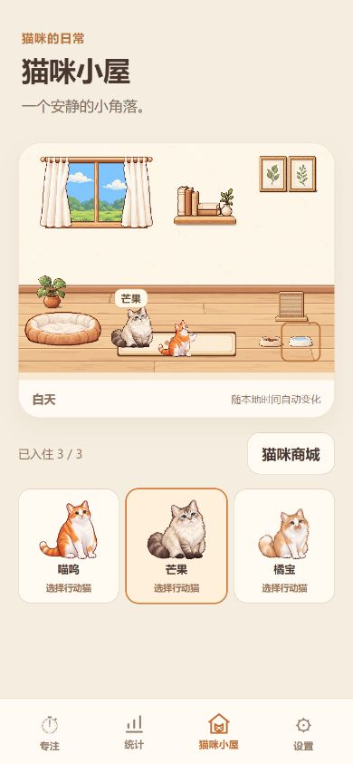

# 取消附近待机中转：实施与验证

日期：2026-10-22。本报告替代上一轮关于“动作后附近待机”的规则。

## 已实现

- 新家具指令替换旧动作：安全完成必要退出后，从现有位置直接传送到新目标，不插入附近待机、回地毯或 idle 播放。
- 原占用猫让位：结束旧动作，传送回该猫自己的地毯默认站位并恢复 idle，之后才让请求猫进入家具。
- 动作自然完成、取消且无后续指令：回默认地毯站位，沿用原冷却和最近动作记录。
- 原有淡出/淡入必须安全完成；若新指令到达时已经开始回程淡出，不硬切正在执行的过渡。正式配置仍没有 enter/exit 素材，不虚构动画。

## 文件与实现

- `src/room-behavior.ts`：为任务增加 complete/replace/displace/cancel/suspend 恢复原因；替换时只清理旧动作并交给后继指令。用短暂的准备队列串行处理退出、家具交接与传送，进入 loop/once 后立即释放队列，不等待整个动作结束。暂存旧家具租约直到原位置腾空，失败时回安全地毯并释放；保留命令序号和重复请求去重。
- `src/room-anchors.ts`：删除九个附近 idle 槽位及 idle 类型标记，只保留真实家具交互锚点。
- `src/room-locations.ts`：识别旧 food/bed/play-idle-0..2 并安全忽略，其他合法旧条目仍校验；未知猫和非法位置仍拒绝。
- `tests/room-behavior.test.ts`：更新明确改变的结束位置断言；新增直达一次传送且无 idle、回地毯途中保持占用、两猫交叉申请无死锁、替换加载失败释放旧家具等测试。
- `tests/room-locations.test.ts`：新增旧附近位置兼容测试。
- `tests/room-autonomy-ui.test.ts`：更新后台/切页恢复应为默认地毯位置的断言。
- `README.md` 和本目录：最新规则入口、实际截图及本报告。

## 数据兼容

IndexedDB 保持 **v6**，JSON 备份保持 **v8**。没有迁移、清库或修改专注、所有权、钱包等数据格式。

原 `roomLocations` 仍为猫 ID→锚点 ID 的本机展示设置。旧附近待机条目安全归一化，旧家具位置也不作为恢复动作使用；进入房间统一从各猫已有地毯默认站位开始。新的稳定闲置位置用原有空字典表示，正常保存时写入。临时交互位置、退出和传送状态不持久化。JSON 原本就不包含这一展示设置。

## 实际执行结果

- `npm test`：**42 个测试文件 / 221 项全部通过**；上一轮基线 216 项。原测试保留，受新规则影响的断言按新规则更新。
- `npm run build`：**通过**，包括 TypeScript 检查、Vite 构建及生产缓存生成。无独立 lint 命令。
- 主脚本 `index-GZ1_HDv4.js`：201.55 kB（gzip 51.60 kB）；CSS `index-B6nkY5bg.css`：34.03 kB（gzip 7.56 kB）。没有新增依赖、美术或动画资源。
- 自动化明确验证：吃饭→抓挠时只有一次指向新目标的传送，旧任务不调用 idle；原猫地毯回程未完成时，原家具租约仍归它且新猫未播放动作；回程完成后才交给新猫。退出期间最后有效请求优先、两猫交叉申请、自然结束、取消、加载失败、销毁与后台恢复均通过。
- 原计时、暂停恢复、统计、任务清单、经验/猫爪币、签到、商城、主陪猫与备份兼容测试全部随全量测试执行。

### 电脑生产浏览器

使用独立 `127.0.0.1:4211`，通过现有导入 UI 装载合成三猫备份，未操作用户现用 4195 数据。

- 实际画面/DOM 确认指令后可切到抓挠。动画名称等待定位器曾超时，随后读取画面仍见正确动作，因此这些定位器超时本身没有记为通过；“直达一次、无中间 idle”的精确时序由自动化验证。
- 水盆交接确认：芒果为 drink:loop，喵呜为 idle 且位于原默认地毯站位（图片 left 42.9688%、top 75.2866%），其余猫未重叠占用水盆，三猫透明度均为 1。
- 切到设置再回小屋，三猫恢复默认地毯位置，不恢复附近待机位置。
- 320/360/390 × 740 模拟视口：无横向溢出；4:3 比例保持，五个家具热区最小约 44px。
- 浏览器读取到的 error 日志为空。测试页已关闭，视口恢复，4211 预览服务已停止。

## 未验证及限制

- Android/iPhone 真机、真实触屏、安装后 PWA、系统回收与真实后台恢复未实测，模拟视口不能替代。
- 本轮未重复物理断网和手机文件分享器测试；电脑实际完成测试备份导入，存储/备份和后台行为由全量自动化覆盖。
- 正式进入/退出片段仍缺失；有真实片段时的退出顺序继续由已有可选阶段测试覆盖，不宣称正式退出动画完成。
- 原并发上限和吃饭区互斥保护保持不变；没有扩大其他猫的并行规则。

## Git

实施前后 `git status`、`git remote` 均返回 not a git repository。没有初始化、提交、推送或 commit hash，修改保留在本地；未执行 reset、清理或强制推送。无法提供 Git diff/上游同步状态。针对本轮代码/测试的常见 GitHub token 和私钥特征扫描无匹配。
