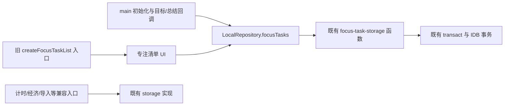

# ADR-001｜LocalRepository 薄适配与同步边界

日期：2026-10-25。状态：本阶段决策已实施；未来同步规则尚待确认。

## 依据与本轮基线

实际仓库为 `D:\MyDesktopPet\cat-focus-pwa`，当前分支 `feature/supabase-auth-test`，remote 为 `https://github.com/WXPwhisper111/cat-focus-pwa.git`。开始时 HEAD 与审计基线 `a306c3a59e91b9d468b921f22f1d0d83cddc8271` 完全相同，已跟踪文件无差异，功能分支尚未配置上游。

依据此前的《v0.2.2-indexeddb-architecture-audit.md》选择首条可验收调用链；该审计报告是本轮开始前已有的未跟踪参考文件，本轮不修改、不暂存。原有未跟踪美术目录和所有 `sources/` 保持原状。本轮适用根目录 `AGENTS.md` 与用户给出的 Git 工作规范；不属于发布用户可见版本，不改发布说明或更新弹窗。

## 已确认方向与本阶段决定

1. 继续 Local-first：IndexedDB 保留本地事实与现有事务，后续采用 Supabase 同步方向。本轮不实现任何云同步、账号入口、UID 分区、outbox、迁移、业务表、RPC 或 RLS。
2. 首条调用链选择专注清单/目标：新增、读取、编辑、完成/恢复、删除、选择/清除目标、从专注总结显式完成任务及页面刷新。其余领域暂不迁移。
3. `createLocalRepository(db)` 接收调用者持有的连接，不打开、关闭或缓存连接；每次应用初始化成功打开数据库后创建新适配对象。构造时无持久化 I/O，不创建全局单例。
4. `LocalRepository.focusTasks` 暴露最小 `FocusTaskRepository` 契约：list/add/change/getState/select/completeSummary。类型从既有存储函数参数和返回类型派生，保留可选时钟、expectedUpdatedAt、错误、Promise 与返回语义。
5. 方法直接返回既有函数的 Promise；不包第二层 IDB 事务、不拆方法内部事务、不吞错误、不缓存读取、不附加补偿或奖励。
6. 主应用与新页面工厂 `createFocusTaskListWithRepository` 使用 Repository；原 `createFocusTaskList(db,...)` 保留为兼容包装。`focus-task-storage.ts` 的所有原函数签名、导出和实现不变。
7. `storage.ts` 与领域规则文件保持不变。DB 名称 `cat-focus-pwa`、DB v6、8 stores、JSON 备份 v10、钱包/签到/购买/导入语义及认证行为均保持原样。

迁移后的关系：

任务开始时的快照读取仍属于 `startFocus` 的原事务；备份导入中的任务写入仍属于 `importBackup` 的原事务，不能为了“全部经过 Repository”拆出单独任务事务。完整写入口清单见 [持久化写入口清单](persistence-write-entrypoints.md)。

## 建议默认值（未实现，不代表产品规则已确定）

- 按领域逐条迁移调用链，接口先覆盖真实需求；暂不建立万能 CRUD、全库 Repository 或远端抽象。
- 下一步先定义备份/影子迁移验证及用户归属规则，再做非经济同步。冲突默认保留双方并中止有争议的覆盖，不使用客户端时间决定全部字段胜负。
- 非经济同步仅传专注事实、任务、类别等约定数据；经验仍从记录推导，不上传另一份可相加的经验余额；进行中的倒计时继续设备独立。
- 构造连接所有权、事务归属与错误传播保持明确；未来新增同步元数据必须独立评审，不悄悄加进这个适配器。

## 后续非经济同步不得触发历史奖励

**这是后续实现的硬边界，本轮没有实现同步写入。**

- 拉取/导入历史 FocusRecord 不得通过 startSession/startStopwatch/settle 重演，不调用 awardFocusCoins、checkinToday、grantDevelopmentCoins、purchaseProduct 或资格领取来“补齐”状态。
- 不得因为历史累计时长增加而重算历史钱包余额；现有旧记录、迁移前时长、零币 receipt、paid/waived、规则版本及未结算边界需可区分。
- 同一历史记录重放不能发币、补签到、补免费猫，不能生成新总结或自动完成任务；任务完成本身没有经济奖励，适配器必须保持这一点。
- 若后续需要新的远端应用入口，应明确标记来源并在隔离数据上验证“历史记录可见、经验按既有规则推导、钱包/流水/凭据/资格不被改写”。不要直接把旧 JSON 恢复接口当成一般增量同步接口。

## 待确认规则

| 问题 | 本轮处置 |
| --- | --- |
| 两份离线经济历史选择哪个基线、重复签到/消费如何对账 | 不实现自动合并，不求余额并集 |
| 登录后数据归属、账号退出/切换与本机访问策略 | 保留现有认证测试隔离，不绑定业务库 |
| 离线消费暂定还是要求联网确认、补签时间窗和统一时区 | 无默认业务变更，另行确认 |
| 删除墓碑、水位、过期设备和重连、专注删除对奖励的影响 | 当前任务仍硬删除，类别仍归档；本阶段不加同步删除规则 |
| 哪些偏好、房间位置或装备需要跨设备 | 本轮不改变持久化范围 |
| 云端表、RLS、RPC、奖励规则版本、UID 数据分区 | 保留审计建议作为参考，未创建或执行 |

## 验收与回滚

新测试使用 fake-indexeddb 和 jsdom，不打开真实浏览器用户存档。直接存储与 Repository 运行同一任务链，比较全部 stores 的键和值；验证经过真实结算后的显式任务完成不改变钱包、记录或总结；注入任务写入/删除、选择清理失败，核对整个本地状态回滚；保留并发旧版本拒绝和关闭连接错误。UI 测试验证通过注入契约完成 CRUD、选目标以及失败重试。

本轮实测结果另见 [Repository 阶段验证记录](repository-stage-validation.md)，不沿用此前审计中的测试数量作为本阶段证据。

撤回适配只需恢复主应用及清单的调用连接、移除适配器和新增测试；不需要数据库降级、数据迁移或备份转换。原存储实现和兼容入口始终保留。
