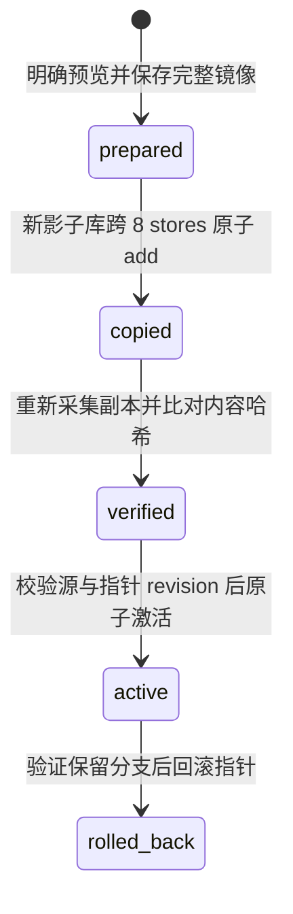

# ADR-002｜V0.2.3 本地数据保护与账号隔离

日期：2026-10-25。代码起点：`ab5e9ac56e5535e932eb18450774d89ce3e16989`，分支 `feature/supabase-auth-test`。

## 已确认的上线边界

用户已明确选择“仅开发页接入”：正式 PWA 继续使用原 `cat-focus-pwa` 访客库，保留免登录和离线体验。本阶段的账号上下文、快照、迁移与恢复入口仅由 `/auth-test` 引用；不进入生产构建、不增加正式账号入口，不创建 Supabase 业务表，不调用云端 RPC、RLS 或同步写入。

依据此前 V0.2.2 审计与 `persistence-write-entrypoints.md`，目前只有任务链经过 LocalRepository。初始化、类别选择修复、计时/结算、签到、购买/权益、房间、JSON 恢复及备份偏好仍直连既有存储。因此不能安全地直接替换正式主应用的全局 db。正式账号入口须等这些写入口具备上下文保护再单独实施。

原有审计文件与未跟踪美术资源只作参考，不混入本阶段提交。所有 sources/ 只读。现有存储实现、DB 名称/版本、8-store schema、JSON v10、奖励公式、游客购买与签到规则均不改动。

## 实施前先验证的安全不变量

先实现快照和纯策略门，再运行独立测试，验证全 store 保真、校验失败拒绝、活动会话阻断、未经验证禁止切换等 9 项不变量，通过后再实现迁移状态机。

之后用隔离库验证：复制失败原子回滚、跨阶段中断后续跑、坏影子副本不修复/覆盖、指针提交失败不切换、旧 UID 的事务与结果撤销、独立钱包不相加、恢复失败保留当前指针。没有为此打开真实用户存档。

## 数据库与上下文设计

| 数据库 | 用途 | 写入约束 |
| --- | --- | --- |
| `cat-focus-pwa` | 正式 PWA 原访客库 | 新保护工具只通过明确预览操作只读打开，不执行 openDatabase 的初始化或旧版本升级 |
| `cat-focus-pwa-user-<UID>-shadow-<migrationId>` | UID 所属的独立数据分支 | 同样的业务 v6 schema；创建空库后原子 add 原始行，不清空、不 upsert 旧记录；副本验证通过后才能成为当前分支 |
| `cat-focus-local-protection-v1` | 新增、独立的迁移日志库，版本 1 | accounts 指针、jobs 状态、snapshots 完整镜像、guestClaims 源归属；只更新元数据，不改原访客业务库 |

日志 stores：accounts 主键 uid；jobs 主键 id，uid 索引；snapshots 主键 id；guestClaims 主键 sourceDatabase。账号指针包含 UID、当前物理库、迁移 ID 与递增 revision；每个迁移保留原指针，支持回滚。快照不会被同 ID 不同内容覆盖。

不暴露账户原生 IDBDatabase 给界面。`taskRepository()` 返回绑定 UID、上下文代际及指针 revision 的能力；每次调用重新校验指针，事务开始前校验身份。换号/退出/切换分支会撤销旧能力、中止未提交事务、关闭连接；迟到打开成功的连接立即关闭，旧结果不得写到另一账号。已在撤销前完成的 A 事务仍属于 A 的分支，不能假装能撤回已提交事务。

认证事件只更新内存身份与撤销状态，不打开业务库、不确认归属、不恢复指针到界面、不上传。邮箱认证退出按钮在等待远端退出前先暂停保护上下文；退出请求失败时保护面板保持暂停，重新刷新/核对认证后才能继续。

## 完整快照

`cat-focus-local-migration` / version 1 是新增迁移专用格式，**不是修改旧版业务 JSON 备份**。包含原 8 个 stores 的全部键和值，以及来源数据库、所有者、采集时间、业务 DB 版本、内容 SHA-256 与整个信封的校验和。

覆盖 records、wallet、walletTransactions、coinReceipts、categories、focusTasks、active 和 settings。settings 包括猫咪/扩展资格/名字、家具库存/购买/装备、签到/paid 与 waived、任务/类别选择、计时偏好、待展示总结、roomLocations 和备份提醒。快照可以保存 active 的原始值，但迁移/激活和回滚有活动会话时拒绝，不丢弃或跨设备延续计时。

采集使用同一个跨 8 stores 的只读事务。schema 必须恰为已核对的 v6、主键一致且无未知索引。业务验证复用 parseBackup、钱包/商城/资格等校验，另查活动状态、总结与记录、入住位置和偏好；只验证，不调用旧导入、结算、签到或内容初始化。原始行不因解析器规范化而被改写。

未知 settings、不能安全 JSON 表示的类型、坏校验和或关联不一致会拒绝，不静默删字段继续。Auth 会话、令牌、.env、localStorage 展示偏好和 Cache Storage 不进入镜像。SHA-256 需要 localhost/HTTPS；不降级到弱校验。

## 首次登录与经济基线

1. 登录仅提供 UID。用户可保持未归属状态，正常访客 PWA 不受影响。
2. 明确点击预览才读取源库、持久化完整镜像及 prepared 日志；显示 UID、记录/资产/钱包摘要及内容哈希。
3. 用户导出完整镜像，确认已保存，并手动选择“使用这份独立钱包，不与其他钱包相加”。决定绑定具体 UID 和快照哈希。
4. 账号已有独立分支时默认拒绝。只有另行明确选择“使用新分支、原分支归档保留”才可以切换；不是合并，不将余额相加，也不清除任一分支。
5. 决定中 `cloudEconomyBaseline = not-configured`：这里只选择本地基线候选，不宣称完成云端经济初始化。以后云端首次基线仍须经过独立确认与服务端协议。

首次激活在同一元数据事务中登记 guestClaims。此后其他 UID 不能通过保护工具再次预览/导出该源或利用之前 prepared 的计划抢领；回滚不自动释放此归属。没有实现把一个账号存档转给另一个账号的功能。

产品策略已编码为接口：共享经济购买要求联网和服务端确认；由于本轮没有云端确认服务，即使 online=true 也拒绝。业务时区初值为 null，时区变更、补签规则明确标记待定义，historicalRewardReplay=false。不改变游客模式原有离线经济，也不因为迁移调用 checkinToday、awardFocusCoins 或补发历史奖励。

## 状态机与中断恢复

失败保持最后成功阶段，并向用户报告。失败副本、日志、原库均不自动删除。重复执行同一已激活计划返回现有指针，不再入账；rolled-back 或已被后续分支取代的旧请求不能重新激活。

- 复制中断：跨 store 单事务，要么完整写入，要么影子库仍为空；仅允许在该任务专属空影子库补写。非空副本只能核验，不能覆盖“修复”。
- 日志中断：如果数据已复制但 copied/verified 日志尚未保存，重试先核对副本，避免重复写业务行。
- 切换中断：accounts、jobs 与 guestClaims 同一事务，比较原指针 revision；失败不留下半个新指针。并发计划最多一个成功。
- 源变化：复制前及激活前重新读取源内容摘要，发现差异要求重新预览。源从不写入，活动状态不强制结束。
- 恢复文件：先完整验证、检查归属及经济决定，再复制到全新影子库；不是向现有业务库执行 importBackup。坏文件不分配迁移任务或影子库。
- 回滚：验证当前及原分支后仅修改指针。首次迁移回滚到“账号未归属”，不会自动把账号权限扩展到访客库。新分支的新增数据保留，可通过 exportArchivedBranch 导出最新镜像，再按明确选择恢复为另一个新分支。

## 已知残余风险与未完成能力

- IndexedDB 不能跨两个数据库原子提交。源库在最后一次检查与元数据指针提交之间仍可能被其他旧页面写入；工具要求关闭其他 PWA 页面，并明确复制已确认的时间点。晚到内容仍在原库中，不能声称一定已包含在副本中。未来正式切换须让所有写入口遵守冻结/上下文协议，再验收跨标签页。
- 这里是应用层数据归属隔离，不是浏览器同源沙箱内的加密隔离。恶意同源脚本、开发者工具或同一 OS 用户仍可能直接访问 IndexedDB。快照明文且可能含任务标题/名字；校验和不证明来源可信，也不替代设备外备份或未来云端权限。
- 正式 PWA 仍是原访客模式；开发页登录 A/B 不改变正式 PWA 的访客可见数据。不要把本阶段能力称为“正式应用已支持安全账号切换”。
- 原库、完整镜像、影子库和归档分支会占额外空间；只测试了模拟配额失败，未做各手机浏览器大容量、系统清理、磁盘损坏及断电实测。没有自动清理策略，避免误删。
- 不支持自动修复旧版本、未知 store/设置、坏账本或坏原分支。回滚验证失败会停留当前分支；可以用经验证的设备外快照明确恢复到新分支，损坏分支继续保留。
- Meta 存储被手工删除后，不猜测和自动接管孤立影子库；需使用用户保留的完整快照恢复。归属转移、持久化加密、云端经济基线、业务时区/补签、同步队列和云同步均未实现。
- 访客源归属按本机源数据库名保守锁定；来自另一设备、同名但未绑定 UID 的访客镜像可能被拒绝，不能自动证明那是另一份来源。已携带匹配 UID 的账号镜像可按验证流程恢复；跨源转移/解除归属需要后续独立设计。

## 后续顺序

先迁移并保护所有剩余写入口，建立跨标签页冻结/代际机制；再以隔离账号做实际浏览器/Android 的备份恢复与断电/容量演练；确认归属转移和存储保留策略；最后才设计正式账号入口和非经济同步。经济同步仍需另行评审与验收。
